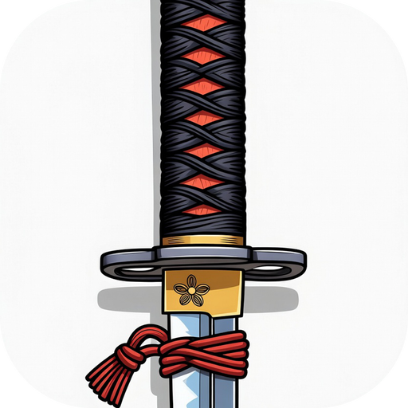

  

<h1 align="center">Katana</h1>

  <strong>Slice through your camera roll.</strong> 
  A free, private iPhone app for cleaning up your photos and videos, one swipe at a time.

---

Your camera roll fills up with blurry shots, duplicates, old screenshots and videos you'll never watch again. Katana shows them to you one at a time so you can decide quickly, then clears out everything you rejected in one go.

## What it does

| Gesture | What happens |
| --- | --- |
| **Swipe right** (or tap ✓) | Keep the photo. Katana won't show it again. |
| **Swipe left** (or tap ✗) | Move it to Katana's Archive. Nothing is deleted yet. |
| **Double-tap** | Add it to (or remove it from) your Favorites in Apple Photos. |
| **Undo** (↩) | Take back your last decision. |

- **Filters:** sort through **All** items, just **Screenshots**, or just **Videos**.
- **Archive tab:** review everything you swiped left, see how much space it takes up, and tap any item to keep it after all. When you're happy, tap **Delete** to remove the whole archive at once.
- **Progress is saved.** Close the app whenever you like and pick up where you left off. The **⋯** menu shows how many items you've reviewed and lets you start over.

## Your photos stay yours

- **Everything happens on your iPhone.** Katana has no servers, no accounts, no ads and no tracking, and it never uploads anything.
- **Nothing is deleted behind your back.** Swiping left only adds a photo to the Archive. Photos are deleted only when you tap **Delete** in the Archive *and* confirm in the iOS dialog that follows.
- **Deletions can be undone for 30 days.** Deleted items go to **Recently Deleted** in the Photos app, where you can recover them.
- Katana asks for access to your photo library so it can show, favorite and delete items. Choose **Allow Full Access** to sort your whole library. If you choose **Limit Access**, Katana only sees the photos you picked.

## Install it on your iPhone

Katana isn't on the App Store. You build it yourself with Apple's free developer tools, which takes about 15 minutes the first time. You don't need to know how to code.

**You'll need:**

- A Mac with **Xcode 16 or newer** (free from the [Mac App Store](https://apps.apple.com/app/xcode/id497799835))
- An iPhone running **iOS 17 or newer** and a USB cable
- An **Apple ID** (the free one you already use is fine; no paid developer account needed)

**Steps:**

1. **Download Katana.** On this GitHub page, click the green **Code** button, then **Download ZIP**, and unzip it. (Or, if you use git: `git clone https://github.com/drmeph/katana.git`.)
2. **Open the project.** Double-click `Katana.xcodeproj` to open it in Xcode.
3. **Sign in with your Apple ID.** In Xcode, open **Xcode → Settings → Accounts**, click **+**, and sign in.
4. **Choose your signing team.** In the left sidebar, click the blue **Katana** project icon. Under **Targets**, select **Katana**, open the **Signing & Capabilities** tab, and pick **Your Name (Personal Team)** from the **Team** menu.
   - If Xcode shows an error that the bundle identifier isn't available, change **Bundle Identifier** from `dev.katana.photosorter` to something unique, such as `com.yourname.katana`.
5. **Connect your iPhone.** Plug it in, unlock it, and tap **Trust** if your iPhone asks whether to trust this computer.
6. **Turn on Developer Mode.** On your iPhone, open **Settings → Privacy & Security → Developer Mode**, turn it on, and let the iPhone restart. Confirm with **Turn On** after it restarts. (This option only appears after the iPhone has been connected to Xcode.)
7. **Install the app.** In Xcode's toolbar, choose your iPhone from the device menu at the top of the window, then click the **▶ Run** button (or press **⌘R**). The first run can take a few minutes.
8. **Trust yourself as a developer.** The first time, your iPhone will refuse to open the app. Go to **Settings → General → VPN & Device Management**, tap your Apple ID under **Developer App**, and tap **Trust**.
9. **Open Katana**, tap **Allow Photo Access**, choose **Allow Full Access**, and start swiping.

> [!NOTE]
> With a free Apple ID, apps you install this way stop opening after **7 days**, and you can have at most **3** of them on your iPhone at once. Your progress isn't lost. To renew Katana, connect your iPhone and press **▶ Run** in Xcode again.

## Try it on your Mac first

You can run Katana in the iOS Simulator without an iPhone or any signing:

1. Open `Katana.xcodeproj` in Xcode.
2. Pick any iPhone simulator from the device menu at the top and press **⌘R**.
3. Drag a few photos from Finder onto the simulator window to add them to its photo library.

## Troubleshooting

<strong>“Untrusted Developer” when opening the app</strong>

Follow step 8: **Settings → General → VPN & Device Management**, tap your Apple ID, then **Trust**.

<strong>Xcode says the bundle identifier is unavailable, or “Failed to register bundle identifier”</strong>

Someone else already registered `dev.katana.photosorter`. Change **Bundle Identifier** in **Signing & Capabilities** to something unique, like `com.yourname.katana`, and press Run again.

<strong>I can't find Developer Mode in Settings</strong>

It only appears after your iPhone has been connected to a Mac running Xcode. Plug it in, choose it in Xcode's device menu, press Run once, then look again under **Settings → Privacy & Security**.

<strong>Katana stopped opening after a week</strong>

That's the 7-day limit for free Apple IDs. Connect your iPhone and press **▶ Run** in Xcode again. Your progress and archive are kept.

<strong>Katana says it has no photo access, or only shows some of my photos</strong>

Open **Settings → Apps → Katana → Photos** (on older iOS: **Settings → Katana → Photos**) and choose **Full Access**.

<strong>A photo keeps showing a spinner</strong>

If you use iCloud Photos, the full-size image may still be downloading. Check your internet connection and give it a moment.

## For developers

Katana is a small SwiftUI app with no third-party dependencies. All the code is in [`Katana/`](Katana):

| File | What it does |
| --- | --- |
| `KatanaApp.swift`, `ContentView.swift` | App entry point, tabs, and the welcome and no-access screens |
| `SwipeView.swift` | The card stack, swipe gestures, filters and buttons |
| `ArchiveView.swift` | The archive grid and the delete button |
| `PhotoLibrary.swift` | Loads photos with PhotoKit, tracks decisions and undo, favorites and deletes |
| `DecisionStore.swift` | Saves which items you've kept or archived (in `UserDefaults`, on device) |
| `AssetImage.swift` | Loads a photo or video thumbnail for display |

Issues and pull requests are welcome.
